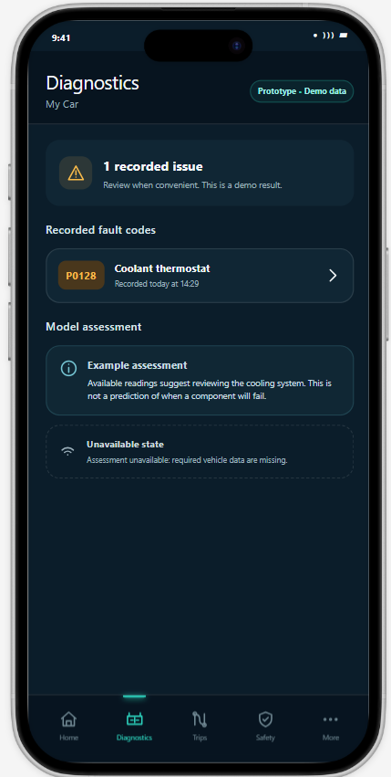
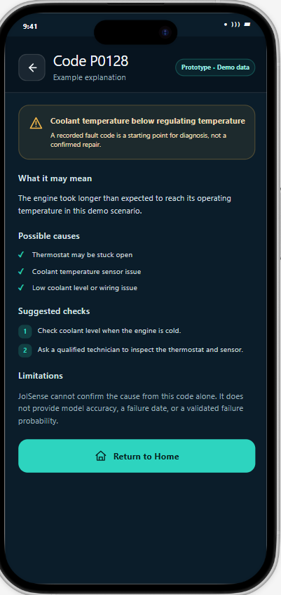
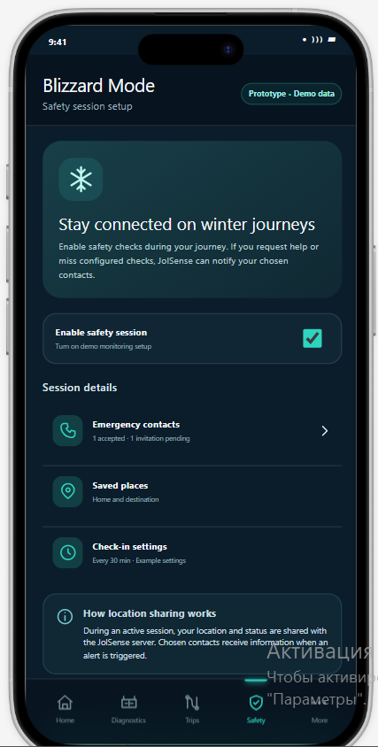
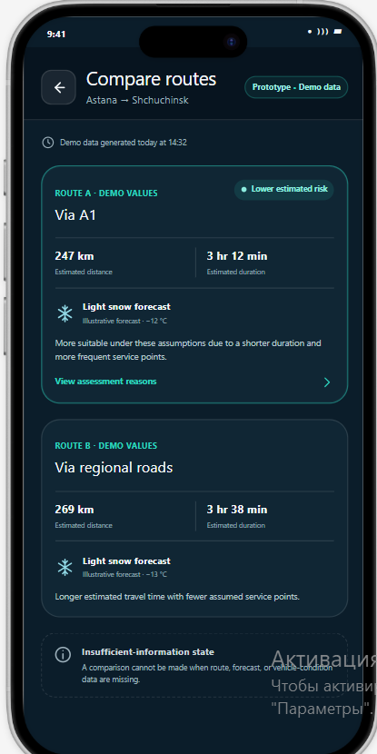

# JolSense UX Prototype

## 1. Purpose and Status

The prototype illustrates how personal vehicle owners will interact
with JolSense's planned diagnostic, journey-assessment, and safety
check-in functions.

Status: UI prototype with demo data.

The screens do not demonstrate working OBD-II communication,
ML inference, weather APIs, vehicle control, or message delivery.

## 2. Prototype Access

Prototype link: [https://creative-moxie-4dca91.netlify.app/](https://creative-moxie-4dca91.netlify.app/)

The link will be added after sharing access is configured and checked.

## 3. Screen Overview

| Screen | Purpose | Main interaction |
|---|---|---|
| Diagnostics | Display recorded issues and an example model assessment. | Select a fault to view its explanation. |
| Diagnostic Details | Explain a sample fault, possible causes, suggested checks, and limitations. | Return to the previous screen or Home. |
| Blizzard Mode | Present safety-session setup, contacts, saved places, and check-in settings. | Configure the planned safety-monitoring workflow. |
| Route Comparison | Compare illustrative routes and explain suitability assumptions. | Open assessment reasons. |

## 4. Screen Previews

### Diagnostics

Shows a sample recorded fault and separates fault-code information
from an illustrative model assessment.

An unavailable-data example demonstrates how missing inputs
will be communicated.

### Diagnostic Details

Shows an illustrative explanation of code P0128, possible causes,
suggested checks, and diagnostic limitations.

The explanation is not a confirmed diagnosis of a real vehicle.

### Blizzard Mode

Shows safety-session setup, emergency-contact status, saved places,
and example check-in settings.

The screen explains that location and status may be shared with
the backend during an active session. Contact notifications are
planned and are not demonstrated as real deliveries.

### Route Comparison

Shows two illustrative routes between Astana and Shchuchinsk.

Distances, durations, weather, and suitability explanations are
demo values, not verified route or forecast information.

## 5. Intended User Scenarios

### Scenario A: Understand a Diagnostic Warning

1. Open Diagnostics.
2. Select the sample fault code.
3. Read the explanation, possible causes, and suggested checks.
4. Return to the previous screen or Home.

### Scenario B: Compare Candidate Routes

1. Enter an origin, destination, and departure time.
2. Request candidate-route comparison.
3. Review available environmental and vehicle-condition information.
4. Open the reasons behind the assessment.

The screenshots document the comparison screen.
The complete interaction flow still requires verification.

### Scenario C: Configure Blizzard Mode

1. Open Safety.
2. Review the location-sharing explanation.
3. Configure opted-in emergency contacts and check-in settings.
4. Request safety-session activation.
5. Display active server monitoring only after registration succeeds.

The screenshot documents setup only. Active monitoring, check-in,
pause, help-request, and alert-status screens must also be documented
when available.

## 6. Interface Decisions

- Consistent dark background with teal primary actions.
- Warning icons accompanied by explanatory text.
- Visible labels identifying demo data.
- Separate recorded faults and model assessments.
- Explicit missing-data states.
- Explanations alongside route recommendations.
- Contact-consent status and location-sharing information.

## 7. Prototype Limitations

- Screenshots demonstrate interface design, not system functionality.
- Clickable transitions have not yet been verified in this document.
- No actual vehicle readings or model results are reported.
- Route and weather values are illustrative.
- Safety thresholds and check-in intervals are examples.
- No real emergency-contact messages are sent.
- Remote-control and maintenance screens are not included
  in the four screenshots documented here.

## 8. Review Checklist

- [ ] Add the shared prototype link.
- [ ] Check that reviewers can open the link.
- [ ] Verify diagnostic-screen navigation.
- [ ] Verify trip-planning and route-detail transitions.
- [ ] Document Blizzard Mode check-in and alert states.
- [ ] Add maintenance and remote-control previews when available.
- [ ] Check that all sample values are labelled as demo data.
- [ ] Check that all image links display correctly.